# Node + React + Postgres Platform

A small full-stack app (React frontend, Express backend, PostgreSQL) used as
a DevOps take-home assessment. It is built up in stages: local containers
first, then a local Kubernetes cluster, then Ingress, CI/CD, platform
services, and observability.
The sections below describe the stages available on this branch.

## Architecture

The platform runs on a three-node kind cluster. This diagram shows the
application, metrics and logging paths using the namespaces in this repository.

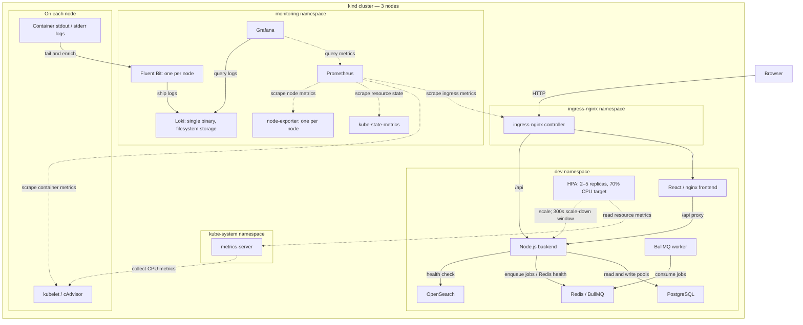

Both backend database pools connect to the same PostgreSQL instance in
this local setup. The worker consumes BullMQ jobs through Redis;
OpenSearch currently provides a health-check endpoint rather than a worker
indexing pipeline. Ingress uses plain HTTP locally. The HPA keeps the
highest scale-down recommendation over the previous five minutes.

## Repo structure

```
.
├── backend/
│   ├── src/                  # Express API (index.js), db.js, redisClient.js,
│   │                         # queue.js, worker.js, search.js
│   └── .env.example          # env vars for running the backend without Docker
├── frontend/
│   ├── src/                  # React app (App.jsx, main.jsx)
│   ├── nginx.conf.template   # envsubst'd into nginx's config at container start
│   └── vite.config.js
├── k8s/
│   ├── kind-config.yaml       # kind cluster config (cluster-level, not kustomized)
│   ├── app-secrets.example.yaml   # placeholder shape only, never applied
│   ├── base/                  # namespace-agnostic manifests (configmap,
│   │                           # postgres StatefulSet + services,
│   │                           # backend/frontend Deployments + services,
│   │                           # ingress)
│   └── overlays/{dev,preprod,release}/   # namespace, image tags, ingress
│                                         # host per environment
├── observability/            # Helm values, metrics monitor, dashboard, alerts
├── docs/                     # evidence screenshots
├── docker-compose.yml
├── Dockerfile.backend
├── Dockerfile.frontend
├── .dockerignore
├── .env.example               # docker-compose / Makefile env vars
├── Makefile                   # kind cluster + kubectl bring-up targets
└── .github/workflows/ci-cd.yml
```

## Prerequisites

Versions this was built and tested against:

```
$ docker --version
Docker version 29.9.0, build f415da8

$ kind version
kind v0.30.0 go1.24.6 linux/amd64

$ kubectl version --client
Client Version: v1.37.0
Kustomize Version: v5.8.1

$ make --version
GNU Make 4.3
```

Helm 3 is required for Task 6; tested with `v3.12.3`. Chart versions are
pinned in the Makefile.

---

## Task 1 — Docker Compose

```bash
cp .env.example .env
docker compose up --build -d
```

Open http://localhost:8080.

Reset the database (drops the named volume):

```bash
docker compose down -v
```

### Design decisions

- **Multi-stage builds.** `Dockerfile.backend` separates a `deps` stage
  (`npm ci --omit=dev`) from the `runtime` stage, which only copies in
  `node_modules` and `src/`. `Dockerfile.frontend` separates the Vite
  `build` stage from the `nginx:1.27-alpine` runtime stage. No Node
  toolchain ships in the final image.
- **Non-root backend.** `Dockerfile.backend` runs as the `node` user that
  `node:22-alpine` already ships with, not root.
- **nginx `/api` proxy via `BACKEND_URL` template.**
  `frontend/nginx.conf.template` is rendered by nginx's `envsubst`-on-templates
  mechanism at container start. Its `/api/` location does
  `proxy_pass ${BACKEND_URL};` with no trailing slash, so `/api/items` is
  forwarded as `/api/items`, keeping the prefix the backend expects. The
  same image is used in `docker-compose.yml`
  (`BACKEND_URL=http://backend:4000`) and in `k8s/base/app-configmap.yaml`
  (`BACKEND_URL=http://backend-service:4000`).
- **Only the frontend is published to the host.** In `docker-compose.yml`,
  only `frontend` has a `ports:` mapping (`${FRONTEND_PORT:-8080}:80`).
  `postgres` and `backend` have none, so they're reachable only on the
  Compose network.
- **Healthcheck on `/api/health/ready`, not `/api/health`.** The backend's
  Compose healthcheck calls `/api/health/ready`, which checks Postgres,
  instead of `/api/health`, which always returns `200`. This stops Compose
  from calling the container healthy before it can serve `/api/items`.
- **No secrets in Git.** Credentials live in `.env` (gitignored); only
  `.env.example` with placeholder values is committed.

---

## Task 2 — Kubernetes (kind)

```bash
cp .env.example .env   # skip if already done for Task 1
make cluster ingress metrics images secrets deploy observability logging
```

`make secrets` reads `.env`, so it has to exist before that step.

Add to `/etc/hosts`:

```
127.0.0.1 node-react.local
```

Open http://node-react.local.

The frontend was first a `NodePort` Service (`30080`). Task 3 replaced that
with the Ingress below, so `frontend-service` is now `ClusterIP` only.

Rebuild and roll out a code change:

```bash
make redeploy
```

`redeploy` exists because images are always tagged `backend:dev`/`frontend:dev`
with `imagePullPolicy: IfNotPresent`. After `make images` rebuilds and
reloads the image, a plain re-`apply` is a no-op — kubelet won't re-pull the
same tag. `make redeploy` rebuilds, reloads, then runs
`kubectl rollout restart` on both Deployments to force the new image in.

Tear the cluster down:

```bash
make clean
```

### Design decisions

- **StatefulSet + `volumeClaimTemplates`, not a static PV.** Postgres is a
  `StatefulSet` (`k8s/base/postgres-statefulset.yaml`) with a
  `volumeClaimTemplates` entry, so the controller provisions and binds its
  own PVC. A static PV/PVC pair would need manual provisioning and binding.
- **Headless + ClusterIP Postgres services.** `postgres-headless`
  (`clusterIP: None`) exists only because the StatefulSet needs a
  `serviceName`. `DB_WRITE_URL`/`DB_READ_URL` point at the separate
  `postgres-service` (`ClusterIP`), per the assessment's requirement that
  Postgres be reachable via a ClusterIP service.
- **Separate liveness/readiness endpoints.** The backend's `livenessProbe`
  hits `/api/health/live` (process check only); its `readinessProbe` hits
  `/api/health/ready` (checks Postgres). A Postgres outage pulls the pod out
  of Service rotation without restarting it.
- **CPU/memory `requests`/`limits` set now.** Backend, frontend, and
  Postgres all declare `resources.requests`/`limits` (e.g. backend:
  `100m`/`128Mi` requests, `500m`/`256Mi` limits), because a future HPA
  computes CPU/memory percentage against `requests`.
- **Secret created from `.env`, never committed.** `make secrets` builds the
  `app-secrets` Secret from the root `.env` via
  `kubectl create secret generic ... --dry-run=client -o yaml | kubectl apply -f -`.
  `k8s/app-secrets.example.yaml` is committed but holds placeholder values
  only.
- **`PGDATA` in a subdirectory.** `k8s/base/postgres-statefulset.yaml` sets
  `PGDATA=/var/lib/postgresql/data/pgdata`, a subdirectory of the mount,
  because kind's local-path-provisioner volume root can contain a
  `lost+found` entry that makes Postgres refuse to initialize.

---

## Task 3 — Ingress / API Gateway

`make ingress` installs ingress-nginx from the official kind-specific
manifest, pinned to `controller-v1.15.1` (applied straight from that URL,
not vendored into `k8s/`). `k8s/base/ingress.yaml` routes host
`node-react.local`: `/api` (Prefix) to `backend-service:4000`, `/` (Prefix)
to `frontend-service:80`, with no `rewrite-target` annotation — so
`/api/items` reaches the backend as `/api/items`. Each environment overlay
(`k8s/overlays/{dev,preprod,release}/`) patches the host — `preprod.` and
`release.` prefixes for those two — and sets the namespace; `dev` also
provides the `Namespace` resource the others have their own copy of.

> As of this writing, Kubernetes SIG Network has retired the community
> ingress-nginx project (announced November 2025); best-effort maintenance
> ran only until March 2026, after which there are no further releases or
> security fixes upstream. `controller-v1.15.1` still works for this local,
> time-boxed assessment. A deployment built today should use the Gateway
> API or another controller instead.
> ([kubernetes.io/blog](https://kubernetes.io/blog/2025/11/11/ingress-Nginx-retirement/))

### Request path: Browser → Ingress → Service → Pod → PostgreSQL

1. Browser resolves `node-react.local` to `127.0.0.1` via the `/etc/hosts`
   entry.
2. Connects to `127.0.0.1:80`. kind's `extraPortMappings`
   (`k8s/kind-config.yaml`) forward that into the control-plane node's
   container port 80.
3. The ingress-nginx controller pod listens there via `hostPort` — its
   Deployment is pinned with `nodeSelector: {ingress-ready: "true"}`
   (`make ingress`'s `kubectl patch`), the only label that node carries.
4. The controller matches the `Ingress` object (`app-ingress`, namespace
   `dev`) by host and path, and proxies to `backend-service` or
   `frontend-service` — both `ClusterIP` — not to a pod IP directly.
5. `kube-proxy`'s iptables/IPVS rules for that Service load-balance to one
   of its healthy pod endpoints.
6. For `/api/*` requests, the backend pod queries Postgres through
   `postgres-service` (`ClusterIP`), which routes to the single
   `postgres-0` pod.

### Kubernetes DNS

A pod's `/etc/resolv.conf` (confirmed live inside a `backend` pod):

```
search dev.svc.cluster.local svc.cluster.local cluster.local
nameserver 10.96.0.10
options ndots:5
```

- `nameserver 10.96.0.10` is the `kube-dns` Service's ClusterIP, backed by
  the CoreDNS pods in `kube-system`. CoreDNS watches the Kubernetes API for
  `Service`/`EndpointSlice` objects directly and answers from that live
  state — it isn't reading a static zone file.
- `options ndots:5` means a name with fewer than 5 dots is not tried as
  absolute first. A bare `backend-service` is tried against each `search`
  suffix in order — `backend-service.dev.svc.cluster.local` first (same
  namespace) — until one resolves.
- A fully-qualified name with a trailing dot
  (`backend-service.dev.svc.cluster.local.`) skips the search list and
  resolves in one query.

### Debugging

**(a) Ingress reachable, backend not:**

```bash
kubectl get ingress -n dev app-ingress -o yaml   # host/paths/backend names correct?
kubectl get endpoints backend-service -n dev     # empty = selector matches no Ready pod
kubectl get pods -n dev -l app.kubernetes.io/name=backend -o wide
kubectl describe pod -n dev -l app.kubernetes.io/name=backend   # readiness probe status/events
kubectl logs -n dev -l app.kubernetes.io/name=backend --tail=50
kubectl logs -n ingress-nginx -l app.kubernetes.io/component=controller --tail=50   # 502/503 upstream errors
```

**(b) Frontend can't reach backend:**

```bash
kubectl logs -n dev -l app.kubernetes.io/name=frontend --tail=50   # nginx access/error log, actual request path
kubectl get cm app-config -n dev -o yaml          # BACKEND_URL=http://backend-service:4000 ?
kubectl exec -n dev deploy/frontend -- cat /etc/nginx/conf.d/default.conf   # did envsubst render BACKEND_URL correctly?
kubectl get ingress -n dev -o yaml                # /api path rule present, no stray rewrite-target
```

### Evolving to microservices

Splitting the backend into multiple services means adding more path rules to
the same `Ingress` — `/api/users` → `users-service`, `/api/orders` →
`orders-service` — each its own `Deployment` and `ClusterIP` Service. The
DNS and probe patterns already in place don't change. Once routing needs
more than path matching — traffic splitting, canary rollouts, mTLS, per-route
retries/timeouts — move to a dedicated API gateway or the Gateway API.
That's also the direction Kubernetes itself now points to, given
ingress-nginx's retirement above.

---

## Task 4 — CI/CD & Multi-Environment Deployment

`.github/workflows/ci-cd.yml`, triggered on `push` and `pull_request`:

| Branch pattern | Environment |
|---|---|
| `master` | `dev` |
| `pre-release/v*` | `preprod` |
| `release/v*` | `release` |

A `pull_request` run only executes `build-and-test` — `build-and-push`,
`deploy`, and `rollback` are all gated `if: github.event_name == 'push'`
(or `workflow_dispatch` for `rollback`), so PRs never push an image or
touch a cluster.

**Pipeline**: `npm ci` for backend and frontend → backend syntax check
(`node --check`) + `npm test` → frontend `vite build` → (on `push` only)
build both images with `docker/build-push-action` + buildx, GHA layer
cache, tag `<branch>-<short-sha>` (`tr '/' '-'` sanitizes `pre-release/v1.0`
to `pre-release-v1.0`) → push to `ghcr.io` → deploy.

**Deploy target**: an ephemeral `kind` cluster created inside the runner
itself (`.github/actions/deploy-to-kind`), not a long-lived cluster —
because the only cluster that exists for this assessment is `kind` on my
own laptop, which a GitHub-hosted runner can't reach. Each deploy run
installs the same pinned ingress-nginx, applies the target overlay with
that run's GHCR image tag, waits for rollout, then smoke-tests
`/api/health/ready` through the Ingress with the right `Host` header and
fails the job on a non-200. In a real setup, the cluster would be a
persistent one, reached via the kubeconfig of a namespace-scoped
`ServiceAccount` stored as a secret on the matching GitHub Environment —
not implemented here, since that cluster doesn't exist.

**Secrets**: `GITHUB_TOKEN` (short-lived, repo/run-scoped) logs in to
GHCR for both push and pull — no personal access token anywhere. `DB_USER`
/`DB_PASSWORD`/`DB_NAME` are GitHub Actions secrets, read into the
ephemeral cluster's `app-secrets` Secret at deploy time. The GHCR
`imagePullSecret` is created only inside that CI run, directly in the
target namespace, and attached to its `default` ServiceAccount — it is
never written into any committed manifest.

**GitHub Environments**: `dev`, `preprod`, `release` exist as real GitHub
Environments (verified via `gh api .../environments`). `preprod` and
`release` each require my manual review before a deployment proceeds, and
each has a deployment branch policy restricting it to its matching branch
pattern (`pre-release/v*` / `release/v*`) — confirmed live via
`gh api .../environments/preprod/deployment-branch-policies`. `dev` has
neither restriction.

**Rollback**: `workflow_dispatch` takes `environment` + `image_tag` and
redeploys that previously-built GHCR tag through the same ephemeral-cluster
steps as `deploy`. Because `preprod`/`release` carry the branch policies
above, that dispatch must itself be run from a matching branch — GitHub
enforces it at the point the job references `environment:`, regardless of
trigger type. This is the "precise" path. The "fast" path,
`kubectl rollout undo -n <namespace> deployment/<name>`, only makes sense
against a real, already-running cluster with deployment history — it isn't
wired into this workflow since the CI cluster never has any.

**Issues found**:
- `backend/package.json`'s `node --test test/` broke on Node 22 inside the
  `node:22-alpine` image — it tried to resolve `test/` as a CJS module
  (`Cannot find module '/app/test'`) instead of scanning the directory.
  Fixed by changing the script to `node --test test/*.test.js` (shell-glob
  expansion), verified with a passing run and a deliberately-broken one
  that correctly failed.
- A live run on `master` (merge of the Task 4 PR) failed at the `deploy`
  job: `chmod: changing permissions of '/usr/local/bin/kind': Operation not
  permitted` — the hosted runner's user can write into `/usr/local/bin` but
  not `chmod` a file there. Fixed by downloading to `/tmp`, `chmod`-ing
  there, then `sudo mv`-ing into place, for both `kind` and `kustomize` in
  `.github/actions/deploy-to-kind/action.yml`. The fix is already present
  on `origin/master`
  and this branch.

**Evidence:** the passing deployment screenshot
`docs/task4-deploy-run.png` is embedded below.

## Task 5 — Platform Services: Redis, Queue, Search, Read/Write DB

Added `redis` (`redis:7-alpine`), `bullmq-worker` (the backend image,
`command: node src/worker.js`), and `search` (`opensearchproject/opensearch:3.9.0`,
pinned) to both `docker-compose.yml` and `k8s/base/`. `REDIS_URL` and
`SEARCH_URL` are set on the backend and in `k8s/base/app-configmap.yaml`.

**OpenSearch dev config**: `discovery.type=single-node`,
`DISABLE_SECURITY_PLUGIN=true` (disables TLS/auth entirely — dev only,
never outside local), `OPENSEARCH_JAVA_OPTS=-Xms512m -Xmx512m`. No
persistence (ephemeral container storage, data is disposable); memory
requests/limits (768Mi/1Gi) sized above the 512m heap for JVM/off-heap
overhead. Readiness probe on `/_cluster/health`. OpenSearch needs the
host's `vm.max_map_count` at or above `262144`; on this machine it's
already `1048576` (`cat /proc/sys/vm/max_map_count`), so no change was
needed, but if it's too low elsewhere, raise it on the **host**, not in a
privileged init container: `sudo sysctl -w vm.max_map_count=262144` (add
`vm.max_map_count=262144` to a file under `/etc/sysctl.d/` for it to
survive a reboot). This has to be the host, not the kind node container —
it's a single kernel-wide setting, not per-container-namespaced.

`/api/health/redis` and `/api/health/search` both return
`{"status":"ok", ...}` (search: `"cluster":"green"`) against the live
cluster, through the Ingress.

**Read/write routing** lives in application code: `backend/src/db.js`
holds two `pg.Pool` instances, `writePool` (from `DB_WRITE_URL`) and
`readPool` (from `DB_READ_URL`); `write()` always uses `writePool`,
`read()` always uses `readPool`. The alternative is a DB proxy (PgBouncer,
pgpool-II) that makes the split transparent to the app — simpler
application code, but another component to run and one more network hop.

**Replication lag**: a replica can be milliseconds to seconds behind the
primary. Anything that reads its own recent write — a redirect-after-POST
that re-fetches the record, a uniqueness check before an insert, "did my
update actually save?" — must go through `write()`/`writePool` (the
primary), never `read()`/`readPool`, or it risks reading stale data.

## Task 6 — Observability, Scaling & Rate Limiting

Bring up the complete local stack in this order (requires Helm 3 and a root
`.env` with `GRAFANA_ADMIN_PASSWORD` set):

```bash
make cluster ingress metrics images secrets deploy observability logging
```

**Metrics stack:** `make observability` installs
`prometheus-community/kube-prometheus-stack` chart **91.8.2** in `monitoring`:
Prometheus, Alertmanager, Grafana, Prometheus Operator, kube-state-metrics,
and node-exporter. Values and extra resources live in `observability/`,
outside the application Kustomize overlays, so application CI deploys do
not manage the monitoring releases. Prometheus retains 6 hours in ephemeral
storage; Grafana and Loki are also disposable local services. Resource
requests/limits are deliberately small; Grafana has a 512Mi memory limit
because 128Mi caused live OOM restarts during load testing. The Grafana
admin Secret is created from `.env`, rather than embedded in Helm values.

Kubelet/cAdvisor provides container CPU and memory; kube-state-metrics
provides Deployment, HPA and StatefulSet state. The backend has no native
Prometheus endpoint, so ingress-nginx provides request counters and duration
histograms. `observability/ingress-metrics.yaml` exposes port 10254 and
scrapes every 15 seconds with `honorLabels: true`. `make ingress` explicitly
passes `--enable-metrics=true`. Monitor/rule selectors accept our resources
without a Helm release label. `make metrics` installs metrics-server
**v0.9.0**, using `--kubelet-insecure-tls` for kind's self-signed kubelet
certificates; it supplies the HPA resource API independently of Prometheus.

**Grafana:** open http://grafana.node-react.local (add
`127.0.0.1 grafana.node-react.local` to `/etc/hosts` if needed), log in as
`admin` using `.env`'s password. The ConfigMap in
`observability/dashboard-backend.yaml` provisions the **Backend** dashboard
at http://grafana.node-react.local/d/backend-overview/backend with six panels:

| Panel | Signal and purpose |
|---|---|
| Backend CPU usage | Per-pod CPU cores from the 5-minute cAdvisor counter rate; shows load distribution and scaling pressure. |
| Backend memory usage | Per-pod working-set bytes; identifies growth toward the 256Mi container limit. |
| Request rate | Summed 5-minute rate of ingress requests to `backend-service`; shows incoming requests/second. |
| Error rate | Backend ingress 5xx requests as a percentage of all requests; a zero fallback handles absent 5xx series. No traffic can still produce no data. |
| p95 latency | 95th percentile from ingress duration histogram buckets over 5 minutes, in seconds; exposes slow requests. |
| Backend replicas over time | Actual Deployment replicas alongside HPA desired replicas; shows scaling and reconciliation. |

**Six alerts** are installed by `observability/alerts.yaml` and evaluated
by Prometheus; Alertmanager is deployed, with no external notification
receiver configured. These are local assessment thresholds, not measured
production SLOs:

| Alert | Threshold / duration / severity | Why |
|---|---|---|
| `BackendHighErrorRate` | 5xx fraction >5%, sustained 5m; warning | One in twenty failed requests is a material user impact. A 5-minute rate and hold avoid reacting to a single transient error. |
| `BackendHighP95Latency` | p95 >1s, sustained 5m; warning | A second is noticeably slow for this small CRUD API; the hold filters brief cold starts or dependency spikes. |
| `BackendCPUNearLimit` | Per-pod CPU >90% of its limit for 10m; warning | At >450m of the 500m limit, a pod has little room before throttling. Ten minutes gives HPA time to react and excludes short bursts. This compares against limits, whereas HPA uses requests. |
| `BackendHPAAtMaxReplicas` | Current replicas >= max (5) for 10m; warning | Sustained use of all local capacity leaves no autoscaling headroom; the hold avoids alerting on a brief successful scale-up. |
| `BackendPodsNotReady` | Available Deployment replicas < desired for 5m; critical | Persistent missing capacity suggests failed probes, crashes or unschedulable pods. Five minutes allows normal rolling updates and initialization. |
| `PostgresDown` | Ready StatefulSet replicas < desired for 2m; critical | There is one database replica, so its absence blocks DB-backed requests. A shorter hold allows a routine restart but catches a sustained hard outage quickly. |

**HPA:** `k8s/base/hpa-backend.yaml` uses `autoscaling/v2`, targets the
backend Deployment, and keeps **2–5 replicas** at **70% average CPU
utilization of requests**. Each backend requests 100m CPU, so the target
is about 70m per pod, not 70% of its 500m limit. Two pods preserve capacity
when one is unready; 70% leaves headroom; five caps laptop resource use.
`behavior.scaleDown.stabilizationWindowSeconds: 300` explicitly keeps the
highest replica recommendation over the previous **5 minutes**, avoiding
rapid scale-down and oscillation after a burst. It is a rolling window,
not an unconditional five-minute sleep. Scale-up uses Kubernetes defaults.
Live `kubectl get hpa -n dev` resolves CPU metrics and shows two idle replicas.

**Rate limiting:** `k8s/base/ingress.yaml` sets `limit-rps: "10"` and
`limit-burst-multiplier: "3"`: 10 requests/second per client IP with a
burst allowance of 30, per controller replica. Ten is generous for a local
single-user demo while bounding an accidental retry loop; burst×3 absorbs
a normal page load. The annotations cover both `/api` and `/` on this
Ingress. Separate Ingress resources would be needed for API-only limits.
With multiple controller replicas the effective limit can increase; this
cluster runs one. These are ingress controls, not a global application quota.

**Logging pipeline: Fluent Bit DaemonSet → Loki → Grafana.** `make logging`
installs **grafana/loki 7.3.0** (actual Loki image **3.6.11**) and
**fluent/fluent-bit 0.58.2** (Fluent Bit **5.1.2**) in `monitoring`, then
upgrades the existing kube-prometheus-stack release with the same pinned
version and values. `observability/prometheus-values.yaml` provisions Loki
through `grafana.additionalDataSources` with stable UID `loki`, using
server-side proxy access to `http://loki.monitoring.svc.cluster.local:3100`.

`observability/loki-values.yaml` runs one **SingleBinary** replica, replication
factor 1, TSDB schema v13 with a 24-hour index period and filesystem storage
on an explicit `/var/loki` emptyDir. Read/write/backend replicas, external
Memcached caches, gateway, canary, test hook and rule sidecar are disabled.
Loki requests 50m CPU/128Mi RAM and is limited to 200m/256Mi; query concurrency
is two. No PVC means logs disappear on pod replacement, and no retention
policy is configured: long-running use can fill node disk. Authentication
is disabled for this local ClusterIP-only Loki service.

`observability/fluentbit-values.yaml` runs one collector on each of the
three kind nodes, including the tainted control-plane via tolerations.
It mounts `/var/log` read-only, tails `/var/log/containers/*.log` with
Docker/CRI multiline parsing, and enriches records via the Kubernetes API
using chart-created ServiceAccount/RBAC. It emits JSON lines to Loki with
only the explicit stream labels `namespace`, `pod`, `container`, and `app`;
`app` maps from `app.kubernetes.io/name`. Avoiding automatic export of every
Kubernetes label bounds unnecessary stream cardinality. Each collector
requests 25m/32Mi, is limited to 100m/128Mi, and caps the input buffer at 5MB.
Tail offsets live in an emptyDir database and historical files are read
from the head, so collector replacement can replay logs. Retries are
unlimited but memory buffering is bounded; there is no durable outage spool.

**Rejected alternative:** SimpleScalable Loki with object storage and
Memcached would separate read/write capacity and improve scalability, but
adds components, storage credentials and substantial memory for a laptop
assessment. SingleBinary filesystem storage keeps this demo small; it
trades away HA and durable logs. See the official
[Loki chart component defaults](https://grafana.com/docs/loki/latest/setup/install/helm/concepts/)
and [Fluent Bit Loki label configuration](https://docs.fluentbit.io/manual/4.1/data-pipeline/outputs/loki).

Example LogQL queries in Grafana Explore (Loki datasource, last hour):

```logql
{namespace="dev", app="backend"}
{namespace="dev", app="backend"} |= "redis"
```

[Open the exact Grafana Explore query](http://grafana.node-react.local/explore?schemaVersion=1&panes=%7B%22A%22%3A%7B%22datasource%22%3A%22loki%22%2C%22queries%22%3A%5B%7B%22refId%22%3A%22A%22%2C%22expr%22%3A%22%7Bnamespace%3D%5C%22dev%5C%22%2C%20app%3D%5C%22backend%5C%22%7D%22%2C%22queryType%22%3A%22range%22%2C%22editorMode%22%3A%22code%22%2C%22datasource%22%3A%7B%22type%22%3A%22loki%22%2C%22uid%22%3A%22loki%22%7D%7D%5D%2C%22range%22%3A%7B%22from%22%3A%22now-1h%22%2C%22to%22%3A%22now%22%7D%7D%7D&orgId=1)

Live verification on **2026-10-14 (Asia/Dhaka)**: Loki was 1/1 Ready,
Fluent Bit was 3/3 Ready across all three nodes, and Grafana reported
`Data source successfully connected`. Both queries returned the backend
stdout line in **Grafana Explore**, with the requested namespace, pod,
container and app labels. All six dashboard panels returned live series
through Grafana's Prometheus proxy; all six application alerts were loaded,
healthy (`ok`) and inactive. Logging screenshot evidence is linked below.
The Redis filter uses a deliberately generated backend diagnostic line,
`task6 logging verification: redis ping PONG`, from an actual successful
Redis PING written to the backend container's stdout. Healthy Redis requests
are not normally logged by this application, so this checks filtering
without inventing an outage or claiming an existing Redis error.

**Backend logs in Grafana Explore** — `{namespace="dev", app="backend"}`
returns logs from the backend container.

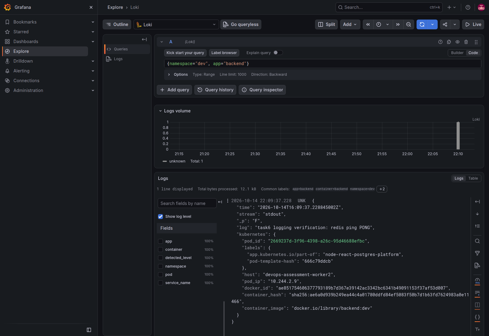

**Redis text filter** — `{namespace="dev", app="backend"} |= "redis"`
matches the successful `redis ping PONG` diagnostic line.

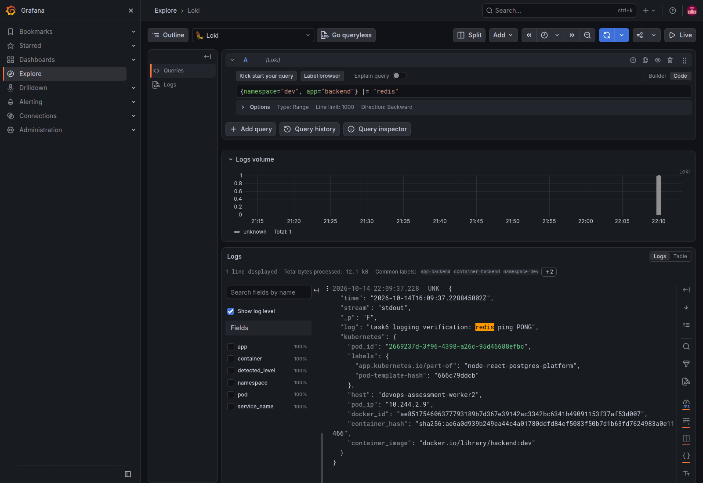

---

## Issues found during testing

### 1. Postgres connection pool crash

Deleting the Postgres pod (`kubectl delete pod -n dev postgres-0`) to test
persistence crashed the backend:

- **Symptom:** `kubectl get pods -n dev` showed both backend pods at
  `RESTARTS: 2` shortly after the postgres pod was deleted.
- **Diagnosis:** `kubectl logs <backend-pod> --previous` showed:
  ```
  failed to initialize schema: Error: connect ECONNREFUSED ...
      at async initSchema (file:///app/src/db.js:30:3)
  ```
  The container had actually crashed and restarted — not just failed a
  readiness check — and on restart it reran `initSchema()` against a
  Postgres that wasn't back up yet, failing again.
- **Root cause:** `backend/src/db.js`'s `writePool`/`readPool` (`pg.Pool`
  instances) had no `.on("error", ...)` handler. When an idle pooled
  connection breaks, `pg.Pool` emits an `'error'` event; with no listener,
  Node treats that as an uncaught exception and crashes the process.
- **Fix:** added `writePool.on("error", ...)` and
  `readPool.on("error", ...)` in `backend/src/db.js` (the same pattern
  already used in `backend/src/redisClient.js`).
- **Re-test:** after `make redeploy`, deleted `postgres-0` again and polled
  `kubectl get pods -n dev` for about 40 seconds. Both backend pods stayed
  at `RESTARTS: 0`. `GET /api/items` still returned the item created before
  the test once Postgres was ready again.

### 2. Ingress controller scheduled off the control-plane node

- **Symptom:** `curl -H "Host: node-react.local" http://localhost/api/health`
  failed with `Recv failure: Connection reset by peer` (curl exit code 56),
  even though the controller pod was `Running` and `1/1 Ready`.
- **Cause:** `kubectl get pods -n ingress-nginx -o wide` showed the
  controller pod on a worker node. The pinned manifest's controller
  Deployment only requires `nodeSelector: {kubernetes.io/os: linux}` —
  nothing pins it to a specific node — so the scheduler was free to place it
  anywhere on this 3-node cluster. But `k8s/kind-config.yaml`'s
  `extraPortMappings` for ports 80/443 only forward into the control-plane
  container (confirmed with
  `docker ps --filter name=devops-assessment-control-plane`). Nothing was
  listening behind the host's port 80 on the node Docker was actually
  using.
- **Fix:** added a `kubectl patch deployment ingress-nginx-controller`
  step to `make ingress`, setting `nodeSelector: {ingress-ready: "true"}` —
  the label only the control-plane node carries. After the rollout,
  `kubectl get pods -n ingress-nginx -o wide` showed the pod on
  `devops-assessment-control-plane`, and the same `curl` succeeded.

### 3. Ingress metrics disabled by the pinned manifest

- **Symptom:** port 10254 exposed Go runtime metrics, but no
  `nginx_ingress_controller_*` request or duration series.
- **Cause:** the pinned ingress controller manifest omitted
  `--enable-metrics=true`; a ServiceMonitor alone cannot enable collection.
- **Fix:** `make ingress` idempotently adds the flag to the controller args.
  The metrics Service and ServiceMonitor then scrape port 10254; backend
  requests populate the counters and histogram used by the dashboard.

### 4. Prometheus target labels hid the routed backend service

- **Symptom:** queries selecting `service="backend-service"` returned no
  ingress series even though scraping was healthy.
- **Cause:** target labels `service="ingress-nginx-controller-metrics"`
  and `namespace="ingress-nginx"` took precedence; metric labels became
  `exported_service` and `exported_namespace`.
- **Fix:** set `honorLabels: true` on the ingress ServiceMonitor endpoint,
  preserving `service="backend-service"` and `namespace="dev"` for the
  dashboard and alert selectors.

### 5. Loki ephemeral storage mount missing

- **Symptom:** Loki exited with `mkdir /var/loki: read-only file system`.
- **Cause:** chart 7.3.0 with single-binary persistence disabled omitted the
  data mount while retaining a read-only root filesystem.
- **Fix:** explicitly mount an emptyDir at `/var/loki`; keep the read-only
  root filesystem and disable the unused rule sidecar.


---

## Known limitations

- `backend/src/db.js`'s `buildConnectionString()` has hardcoded fallback
  credentials (`appuser`/`apppass`/`localhost`/`5432`/`appdb`), used only if
  `DB_WRITE_URL`/`DB_READ_URL` aren't set. Both `docker-compose.yml` and
  `k8s/` always set those, so this fallback path isn't exercised today.

---

## Trade-offs and what I'd do with more time

- TLS on the Ingress with cert-manager (everything is plain HTTP locally).
- Replace ingress-nginx with a maintained controller or the Gateway API.
- Remove the hardcoded fallback DB credentials in db.js and fail fast if DB
  settings are missing.
- Fixed `:dev` image tags need `make redeploy`; CI (Task 4) uses unique
  branch-sha tags instead.
- Durable monitoring/log storage, measured production alert thresholds, and
  an external Alertmanager receiver before operating beyond this local demo.

---

## Evidence

**Task 2 — Kubernetes application resources**

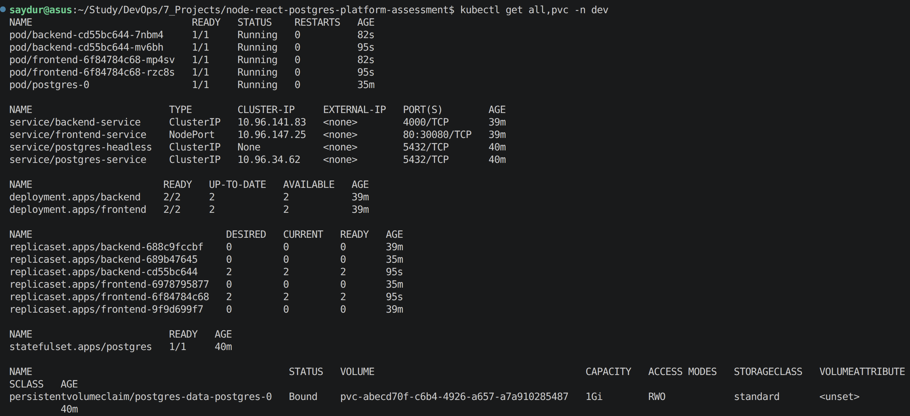

**Task 3 — Application through the Ingress**

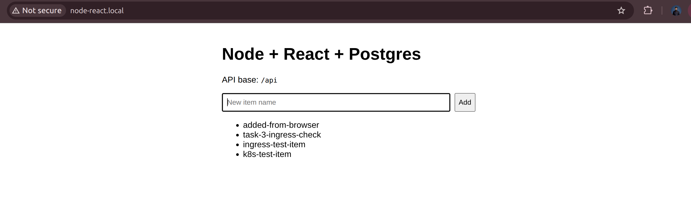

**Task 3 — Ingress controller on the control-plane node**

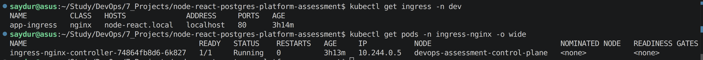

**Task 4 — Passing CI/CD deployment run**

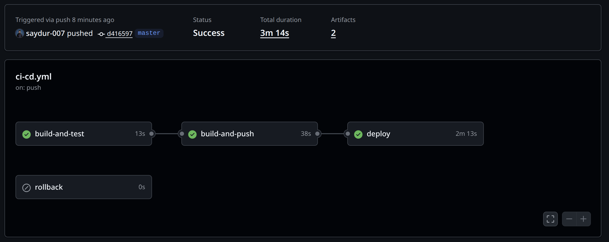

**Task 5 — Redis, queue worker and OpenSearch platform services**

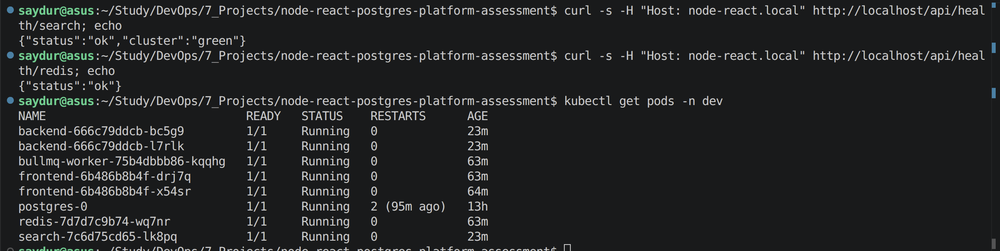

**Task 6 — Six-panel Backend metrics dashboard**

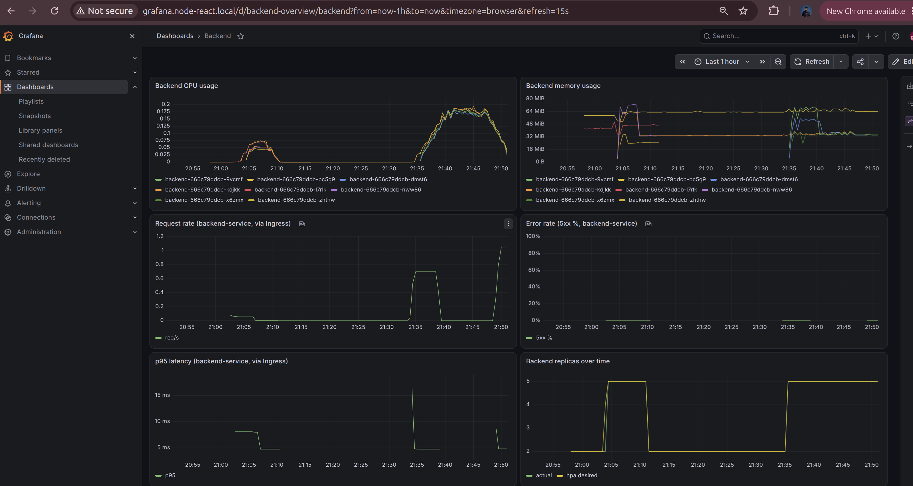

- [Task 6 — Backend logs in Grafana Explore](docs/task6-grafana-logs-backend.png) — embedded in Task 6 above.

- [Task 6 — Backend logs filtered by redis](docs/task6-grafana-logs-redis.png) — embedded in Task 6 above.

### Task 6 — Additional Grafana dashboards

These screenshots show the bundled infrastructure dashboards alongside
the custom six-panel Backend dashboard.

**CoreDNS** — DNS request volume, request types, response codes and response duration.

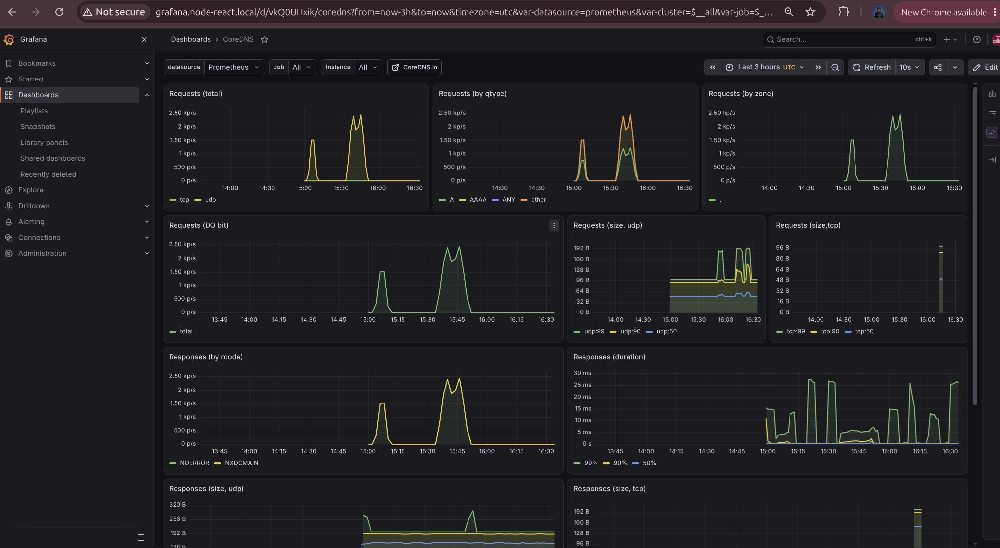

**Grafana Overview** — Grafana build information, dashboards, HTTP request rate and latency.

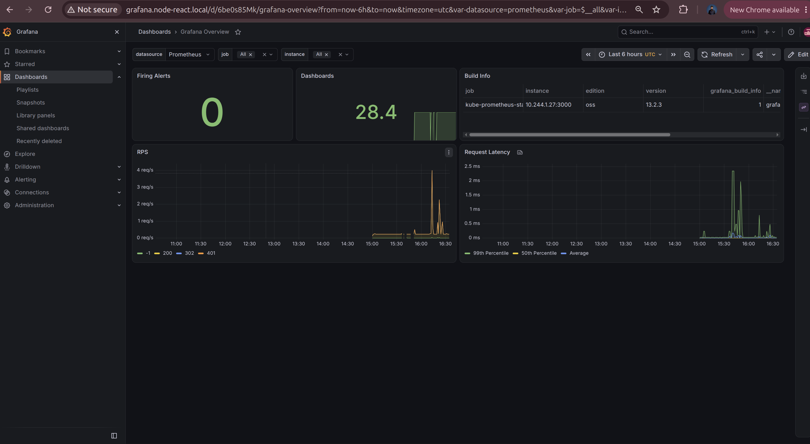

**Kubernetes API server** — API server availability, read/write requests, request duration and work queues.

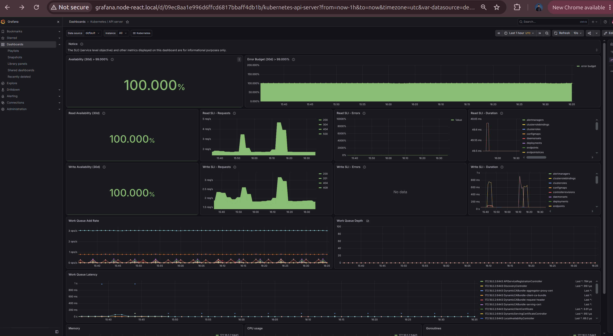

**Node Exporter / AIX** — Node CPU usage, load averages, disk I/O, disk space and network traffic, as shown in the bundled dashboard.

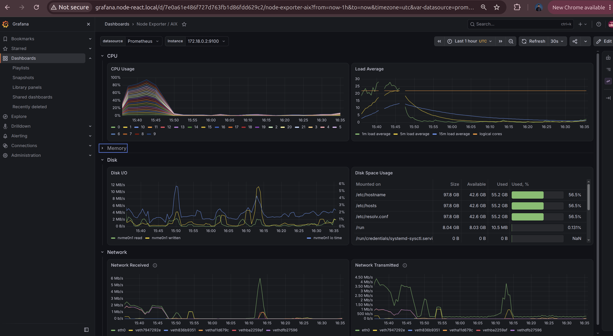

**Node Exporter / USE Method / Cluster** — Cluster CPU and memory utilization and saturation, plus network utilization.

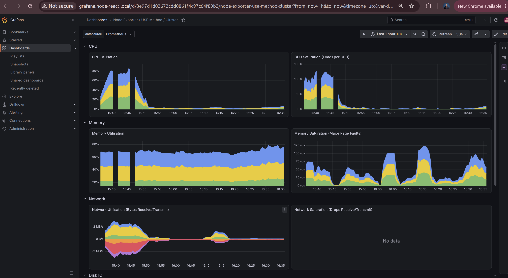
